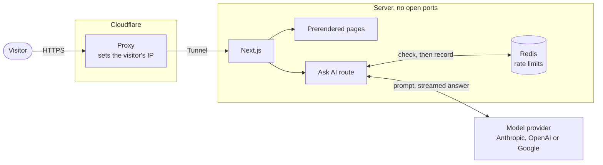
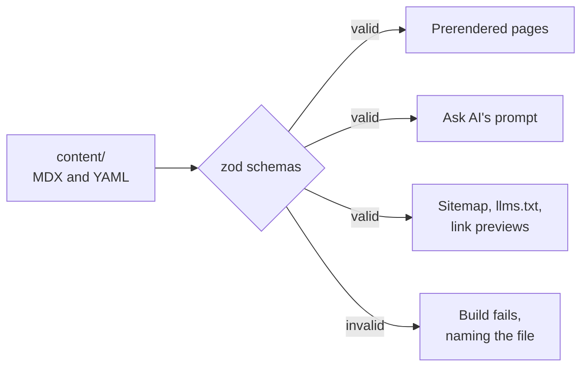
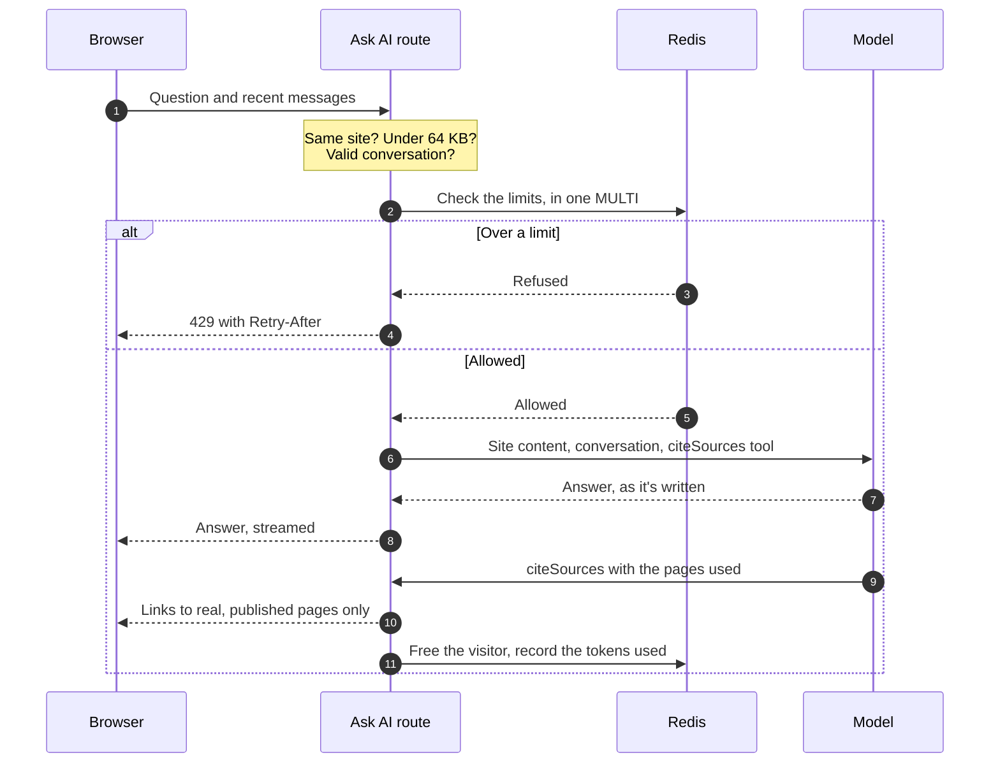
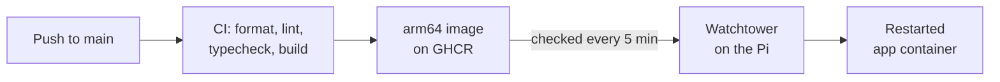

# alexpooler.com

The source of [alexpooler.com](https://alexpooler.com), the portfolio of Alex Pooler, a software engineer. It's laid out like documentation: a page for each project, role and course, a searchable A to Z of skills, and **Ask AI**, an assistant that answers questions about Alex's work using only the content of the site and links the pages it used.

The site is small, but it's built the way a production app would be: typed and validated content, prerendered pages, and an AI feature with its own threat model. This README explains the choices behind it as well as how to run it.

## Stack

| Area      | Choice                                                                            |
| --------- | --------------------------------------------------------------------------------- |
| Framework | Next.js 16 (App Router, Cache Components, Turbopack), React 19, TypeScript        |
| UI        | Tailwind CSS 4, shadcn components built on React Aria, Motion                     |
| Content   | MDX through `@next/mdx`, YAML, validated with zod                                 |
| Ask AI    | Vercel AI SDK (`ai`, `@ai-sdk/react`) with Anthropic, OpenAI and Google providers |
| Limits    | Redis, through the official `redis` client                                        |
| Hosting   | A single Node.js server behind a Cloudflare Tunnel                                |
| Tooling   | pnpm, ESLint, Prettier, Docker, GitHub Actions                                    |

## Architecture

**On each request.** The server only accepts traffic through a Cloudflare Tunnel, so it has no open ports. Pages are already built; Ask AI is the only part that does work per request.



**At build time.** Every page comes from a file in `content/`, checked against a schema. The same content becomes Ask AI's knowledge and what the site tells search engines and AI tools, so none of them can disagree.



Content changes only with a deploy, so every getter is cached with `"use cache"` and `cacheLife("max")`.

## Decisions and why

### Content is data, checked at build time

Every page comes from a file: `content/projects/adsum.mdx` is `/projects/adsum`. Frontmatter is validated by zod schemas in [`src/lib/types/content.ts`](src/lib/types/content.ts). A typo in a date, a skill that isn't in `skills.yaml`, or a heading that clashes with a built-in section fails the build with a message naming the file. A bad edit can't reach production.

MDX is rendered by Next's own `@next/mdx` with a single `mdx-components.tsx`, the way the Next.js docs describe it, rather than a custom compiler. Loading is in two small files: [`loader.ts`](src/lib/content/loader.ts) turns folders into validated data, and [`content.ts`](src/lib/content/content.ts) holds the cached getters that pages use.

### Vercel's AI SDK rather than a provider's own SDK

- **No lock-in.** The model is set by one environment variable, `ASK_MODEL=provider:model`. Moving between Anthropic, OpenAI and Google is a config change, not a rewrite. Provider-specific options, such as Anthropic's prompt caching, stay in one place and other providers ignore them.
- **No hand-rolled streaming.** The browser uses `useChat` and the route returns the SDK's UI message stream. An earlier version had its own streaming protocol and client hook; replacing them with the SDK removed a large amount of code and the bugs that came with it.
- **Typed tools.** Answers cite their sources through a `citeSources` tool rather than by parsing the model's text. The tool's input is a zod schema, and every path is checked against real, published pages on the server, so the model can't produce a broken or invented link.
- **Validation built in.** Conversations from the browser are checked with `safeValidateUIMessages` before anything is sent to a model.

The trade-off is one more dependency between the site and the provider, and new provider features arrive in the SDK slightly later.

### Ask AI treats everything from the browser as hostile

The route ([`route.ts`](src/app/api/ask-ai/route.ts)) runs the cheapest checks first, and nothing is counted against a visitor until the request is valid:



- **Same site:** cross-site requests are refused, using the browser's `Sec-Fetch-Site` header.
- **Under 64 KB:** the body is read in chunks and abandoned past the limit, even with no `Content-Length`.
- **Valid conversation:** the shape, the number of messages, the length of each question, and that it ends with a question. Earlier "assistant" turns are checked too, since the browser sends them and could have changed them.
- **Reasoning stays on the server:** visitors don't need it, and providers reject it if it comes back with part of the conversation trimmed.

The prompt keeps the assistant to Alex's work, tells it not to follow instructions hidden in questions, and has it decline anything off topic. Failures reach the visitor as a plain sentence, never as a raw error.

### Redis for rate limiting

Each answer costs money, so the limits have to hold. They live in [`rate-limit.ts`](src/services/ask-ai/rate-limit.ts):

- **One answer at a time** per visitor, using a lock that expires on its own if the server stops mid-answer.
- **A sliding window** per visitor (12 questions per 10 minutes by default), using a sorted set of timestamps. Refused attempts count too, so repeated retries keep a visitor out until they stop.
- **A daily token budget** for the whole site, counted from the tokens each answer actually used rather than from the number of questions.

All three are checked in one Redis `MULTI`, so two requests arriving together can't both get through. Redis was chosen over in-memory counters because counters in memory reset whenever the server restarts and aren't shared between instances. A limit that a redeploy wipes out isn't a limit.

**It fails closed.** If Redis is unreachable, Ask AI turns itself off rather than answering without limits. Refusals return `429` with a `Retry-After` header, and the browser turns that into a time in the visitor's own timezone.

The provider account has its own spend limit as well, so even a bug in this code can't run up an unbounded bill.

### Security headers

Every response carries `X-Content-Type-Options`, `Referrer-Policy`, `Permissions-Policy`, HSTS, and a Content Security Policy that forbids framing, plugins and redirected forms. There's no `script-src` policy: allowing Next's inline scripts safely needs a new nonce on every request, which would stop pages being prerendered.

### Built to be found, by search engines and AI

Every page declares its canonical address and has its own link-preview tags, with a preview image generated in the site's font. The About page describes Alex as schema.org structured data, and [`/llms.txt`](https://llmstxt.org) and `/llms-full.txt` give AI tools the whole site as plain Markdown. All of it is built from the same content as the pages, in [`src/lib/site-metadata/`](src/lib/site-metadata/), so it can't drift out of date.

## Hosting: built for a Cloudflare Tunnel

> **Running this anywhere else needs one change first.** Read this before deploying.

Rate limits are per visitor, and a visitor is identified by IP address. The server reads that address from the `cf-connecting-ip` header ([`visitor.ts`](src/lib/utils/ask-ai/visitor.ts)). This is only safe because of how the site is hosted:

- Cloudflare sets `cf-connecting-ip` itself and overwrites any value a visitor sends.
- With a Cloudflare Tunnel the server has **no open ports**: the only way to reach it is through Cloudflare. No request can reach it with a forged header.

Anywhere a visitor can reach the server directly, they can send their own `cf-connecting-ip` with a different value on every request and never hit a limit. The daily budget would still cap the total spend, but one person could use all of it.

IPv6 visitors are grouped by their `/64` network, since a single home connection gets billions of addresses.

**To host it elsewhere:**

- **Behind Cloudflare, but not through a Tunnel:** make sure only Cloudflare can reach the server, by allowing only [Cloudflare's IP ranges](https://www.cloudflare.com/ips/) in the firewall or by using authenticated origin pulls.
- **On a platform that sets a trusted client IP header**, such as Vercel's `x-real-ip`, or your own reverse proxy: change `visitorOf` to read that header instead. Never use `x-forwarded-for` as sent by the visitor, since anyone can set it.
- **On serverless platforms:** each instance would open its own Redis connection, so use a Redis service built for that, such as an HTTP-based client.

Until one of these is done, the safe default holds: in production, with no `cf-connecting-ip` header, Ask AI refuses every question and logs why. The rest of the site works normally.

## Deployment

The site runs as a Docker image on a Raspberry Pi 5, and deploys itself when `main` changes:



- **Builds are native arm64.** The image is built on GitHub's ARM runners rather than under emulation, which is many times faster for a Next.js build. Pull requests, including from forks, run the checks but never publish.
- **The image is small and has no secrets.** It's built from Next's standalone output, runs as a non-root user, and has a healthcheck. API keys exist only on the Pi, in `.env`.
- **Updates are pulled, not pushed.** Watchtower on the Pi checks the registry and restarts the app on a new image. GitHub never connects to the Pi and holds no credentials for it, and the Pi accepts no incoming connections.

[`compose.prod.yaml`](compose.prod.yaml) is the site: the app, Redis with its data saved to disk, and `cloudflared` for the Tunnel. The app publishes no ports, which is what makes the Cloudflare header safe to trust (see [Hosting](#hosting-built-for-a-cloudflare-tunnel)). Each image is also tagged with its commit, so rolling back is a matter of pinning that tag.

Watchtower has its own file, [`compose.watchtower.yaml`](compose.watchtower.yaml), because one copy serves the whole server. It can see every container on the machine, so a second copy would race it, and keeping it apart means taking the site down never stops updates for anything else. It updates only containers that opt in with a label, which here is just the app.

## Running locally

Requires Node.js 22+, pnpm and Docker.

```bash
pnpm install
docker compose up -d redis      # Redis for Ask AI's limits, on localhost only (compose.yaml)
cp .env.example .env.local      # then set ASK_MODEL and the provider's API key
pnpm dev                        # http://localhost:3131
```

The site works without the environment variables; only Ask AI needs them. In development, every request counts as one local visitor.

| Script           | Does                                 |
| ---------------- | ------------------------------------ |
| `pnpm dev`       | Development server on port 3131      |
| `pnpm build`     | Production build, validating content |
| `pnpm start`     | Serves the production build          |
| `pnpm lint`      | ESLint                               |
| `pnpm typecheck` | Route types, then `tsc --noEmit`     |
| `pnpm format`    | Prettier                             |

### Environment variables

All of them are read on the server only. See [`.env.example`](.env.example).

| Variable                  | Required | Default | Purpose                                                                 |
| ------------------------- | -------- | ------- | ----------------------------------------------------------------------- |
| `ASK_MODEL`               | Yes      |         | The model, as `provider:model`, e.g. `anthropic:claude-haiku-5-5`       |
| Provider API key          | Yes      |         | `ANTHROPIC_API_KEY`, `OPENAI_API_KEY` or `GOOGLE_GENERATIVE_AI_API_KEY` |
| `REDIS_URL`               | Yes      |         | Redis for the limits. Without it, Ask AI is off                         |
| `ASK_RATE_LIMIT`          |          | 12      | Questions per visitor in the window                                     |
| `ASK_RATE_WINDOW_MINUTES` |          | 10      | Length of the window                                                    |
| `ASK_DAILY_TOKEN_BUDGET`  |          | 2000000 | Tokens a day for the whole site                                         |
| `ASK_MAX_MESSAGES`        |          | 10      | Recent messages sent with each question                                 |
| `ASK_MAX_QUESTION_LENGTH` |          | 500     | Longest question, in characters                                         |

## Project layout

```
content/                Profile, skills and one MDX file per project, role and course
public/                 Static files, including the CV
assets/fonts/           The font the link-preview image is drawn with
src/app/                Routes, including the Ask AI route handler
src/components/         UI: article layout, site chrome, shadcn primitives
src/lib/content/        Loading and validating content
src/lib/site-metadata/  Metadata, structured data and llms.txt
src/lib/types/          All types, with zod schemas first
src/lib/utils/          Small helpers, grouped by area
src/services/ask-ai/    The model, prompt and rate limits (server only)
```

The rules the code follows, such as arrow functions only, named exports at the bottom of each file, and no invented content, are written down in [`CODING-STANDARDS.md`](CODING-STANDARDS.md), with this site's specifics in [`PROJECT-CONTEXT.md`](PROJECT-CONTEXT.md), and enforced by ESLint where possible.

## How it's built

AI coding agents, mainly Claude Code, were used extensively throughout development. The architecture, the technical decisions and the review of every change are Alex's. The repo includes what keeps that workflow consistent:

- [`CODING-STANDARDS.md`](CODING-STANDARDS.md): the project-agnostic rules every change, by a person or an agent, is held to.
- [`PROJECT-CONTEXT.md`](PROJECT-CONTEXT.md): what's specific to this site: its folders, look, content rules and Ask AI.
- [`AGENTS.md`](AGENTS.md): instructions any coding agent reads first.
- [`.claude/skills/update-from-cv`](.claude/skills/update-from-cv/SKILL.md): a repeatable workflow that updates the site's content from a new CV. It plans the changes, asks before deleting anything or guessing, never invents facts, checks the build, and commits on a branch.

## Using it for your own portfolio

The code is MIT licensed; the content isn't (see [Licence](#licence)). To make it yours:

1. Replace everything in `content/` and the CV in `public/`, including the site's address, `url` in `content/profile.yaml`. The schemas in `src/lib/types/content.ts` describe every field, and the build tells you what's missing. With Claude Code, the `update-from-cv` skill can do most of this from your own CV.
2. Set the environment variables, and adjust the prompt in [`prompt.ts`](src/services/ask-ai/prompt.ts) if you want a different tone.
3. Host it behind a Cloudflare Tunnel, or make the change described in [Hosting](#hosting-built-for-a-cloudflare-tunnel) first.

## Licence

The code is released under the [MIT Licence](LICENSE). The content is not: everything in `content/`, the CV in `public/`, and Alex Pooler's name and personal details are © Alexander Pooler, all rights reserved. If you fork the site, replace them with your own. The font files in `assets/fonts/` are under the SIL Open Font License.
